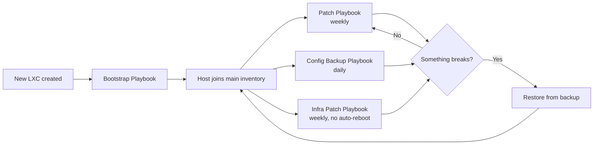

---
tags:
  - Ansible
  - Automation
  - Patch Management
---

# Ansible Automation: The Full Lifecycle

## Overview

The playbooks in this section are not separate scripts. They are stages of one system that manages a Linux host from its creation until a failure needs a restore. This page shows how the stages connect.



---

## Stage 1 — Bootstrap (Day 0)

**[Ansible LXC Bootstrap](ansible-lxc-bootstrap.md)**

Every host's life starts here, and only here. This playbook runs exactly once per host, using temporary root/password access, and hands off to key-based automation from that point forward:

- Creates the dedicated `ansible` service account
- Installs the SSH key the rest of the automation stack will use
- Applies baseline hardening (SSH config, UFW, fail2ban)
- Installs common packages every host needs regardless of role

When this playbook completes, move the host from its one-time `bootstrap_hosts.ini` entry to the main inventory. From then on, you manage it the same as all other hosts in the lab.

!!! note "Bootstrap only covers hosts you create"
    Hypervisors and rented VPS instances never go through Stage 1 — they exist before the automation does. Those hosts need the `ansible` account, key, and sudo set up by hand before they can join the inventory. See [Patch Automation → Step 2](ansible-patch.md#step-2-create-a-dedicated-service-account-on-each-server).

---

## Stage 2 — Ongoing Maintenance (Every Week / Every Day)

Three playbooks run continuously in the background once a host is onboarded, on independent, offset schedules:

| Playbook | Targets | Frequency | Purpose |
|---|---|---|---|
| **[Config Backup](ansible-config-backup.md)** | All hosts | Daily (1 AM) | Archives critical app/system config to the control node |
| **[Patch Automation](ansible-patch.md)** | Application containers | Weekly (Sun 3 AM) | Patches packages, prunes Docker images, reboots when required |
| **[Infra Patch](ansible-patch.md#step-10-patching-infrastructure-hosts)** | Hypervisors, public VPS | Weekly (Sun 4 AM) | Patches packages, **reports** reboot need instead of rebooting |

They run a few hours apart in the same maintenance window, on purpose. The backup runs *before* the patches. Thus, if a patch cycle breaks something, a config snapshot from the same day is always available. You do not depend on the last weekly backup.

```cron
# Daily config backup — 1:00 AM
0 1 * * * ansible-playbook -i hosts.ini backup_configs.yml

# Weekly prune — Sunday 2:00 AM
0 2 * * 0 ansible-playbook -i hosts.ini prune_backups.yml

# Weekly patch, application containers — Sunday 3:00 AM
0 3 * * 0 ansible-playbook -i hosts.ini update_lab.yml

# Weekly patch, infrastructure — Sunday 4:00 AM
0 4 * * 0 ansible-playbook -i hosts.ini update_infra.yml
```

All playbooks target the **same inventory** (`hosts.ini`) — a host is defined once, and which playbook picks it up depends only on which group it's in.

---

## Not Every Host Should Be Patched the Same Way

The instinct is one group, one playbook, everything patched identically. That breaks the first time a hypervisor reboots itself at 3 AM and takes every container with it.

The inventory is split by **how much a bad run costs**, and each tier gets a playbook matched to that risk:

| Tier | Group | Blast radius of a bad run | Reboot policy |
|---|---|---|---|
| Application | `linux_servers` | One service down | Automatic, when required |
| Hypervisor | `proxmox` | Every guest on that host down | Manual only, reported not performed |
| Public VPS | `vps` | Externally visible outage | Manual only, reported not performed |

Two rules fall out of this split, and both matter:

- **Each group needs its own `[groupname:vars]` block.** Groups do not inherit variables. A new group without a block connects as `root`. This fails on each host with `PermitRootLogin no`, and it looks the same as a broken SSH key.
- **A host in no group is a host in no playbook.** When you move `proxmox` and `vps` out of the main group, nothing patches them until you write a play for them. This is on purpose, but it is easy to forget.

---

## Stage 3 — Recovery (When Something Breaks)

This is the payoff for maintaining Stage 2 consistently. When a service breaks — a bad config edit, a corrupted upgrade, a container that needs rebuilding — the recovery path is:

1. **If it's a config problem** → pull the most recent archive from `/root/ansible-backups/<host>/`, extract, and restore the specific file(s) needed (see [Config Backup → Restoring](ansible-config-backup.md#restoring-from-a-backup)).
2. **If the full container has a problem** → build the LXC again from a Proxmox template. Run the [Bootstrap Playbook](ansible-lxc-bootstrap.md) on it. Then restore the configs from the last backup before you put it back in service.

Either path returns the host to Stage 2 — back under normal patch and backup coverage — rather than requiring anything to be reconfigured by hand.

!!! warning "Rebuilding a host at the same IP breaks the control node's SSH trust"
    A new machine at an existing IP presents a different host key, and SSH refuses to connect. Clear the stale fingerprint and reinstall the automation key before expecting Stage 2 to resume. See [Handling a Changed Host Key](ansible-patch.md#handling-a-changed-host-key).

---

## Why This Order Matters

Each stage depends on the one before it actually happening:

- Patch and backup playbooks assume the `ansible` account and SSH key already exist — **skip bootstrap, and neither playbook can even connect.**
- A recovery needs recent backups. **If Stage 2 does not run regularly, Stage 3 has nothing to restore.**

The lesson: the automation is only as good as its weakest stage. A host that you configured by hand and that never went through bootstrap is not in the system. It does not show as a failure. It is just not covered.

The same failure mode applies to hosts that *are* in the inventory but fail every run. A host out of disk, or one whose home directory permissions broke, fails with an `UNREACHABLE` line that scrolls past in a log nobody reads. The rest of the run succeeds, so nothing looks wrong. Make a failure count part of the routine:

```bash
grep -c "UNREACHABLE\|fatal:" /var/log/ansible-patching.log
```

---

## One Inventory, Two Purposes

Worth calling out explicitly: `bootstrap_hosts.ini` and `hosts.ini` are **not** the same file, and that's intentional:

- `bootstrap_hosts.ini` — short-lived, root/password auth, used once per host and then that entry is removed
- `hosts.ini` — the permanent inventory, key-based auth, used by every recurring playbook

A host should only ever exist in one of these at a time. If a host is still listed in `bootstrap_hosts.ini` after it's been through Stage 1, that's a sign the promotion step (moving it to the main inventory) got missed.

!!! tip "Name hosts in the inventory, don't list bare IPs"
    An inventory of bare IP addresses contains no record of what each address actually is. When an IP gets reassigned to a different application, the playbook patches the new machine under the old entry and nothing in the output tells you.

    Named entries (`authentik ansible_host=192.168.1.20`) make the recap readable, make an IP change a one-value edit, and make a mismatch visible. See [Patch Automation → Step 5](ansible-patch.md#step-5-build-your-inventory-file) for a script that generates a named inventory from an existing IP-only one.

---

## At a Glance

| Stage | Playbook | Targets | Trigger | Auth Method |
|---|---|---|---|---|
| 0 — Bootstrap | `bootstrap_lxc.yml` | New LXCs | Manual, once per host | Root + password |
| 2 — Backup | `backup_configs.yml` | All groups | Cron, daily 1 AM | `ansible` user + SSH key |
| 2 — Patch | `update_lab.yml` | `linux_servers` | Cron, weekly Sun 3 AM | `ansible` user + SSH key |
| 2 — Infra Patch | `update_infra.yml` | `proxmox`, `vps` | Cron, weekly Sun 4 AM | `ansible` user + SSH key |
| 3 — Recovery | Manual restore + re-run Stage 0/2 | As needed | As needed | `ansible` user + SSH key |

---

## What's Next

This covers the lifecycle for general-purpose Linux hosts. Natural extensions from here:

- A **health check playbook** to catch problems between scheduled patch/backup runs rather than only discovering them after the fact
- **Failure alerting** — a task that posts the PLAY RECAP somewhere you'll actually see it, closing the silently-failing-host gap that log review alone doesn't
- **Role-specific bootstrap variants** (e.g. a Docker-ready bootstrap for containerized services) once enough hosts share a common "type"
- Moving `backup_root_local` off the control node entirely, so Stage 3 recovery doesn't depend on the control node itself surviving

---
